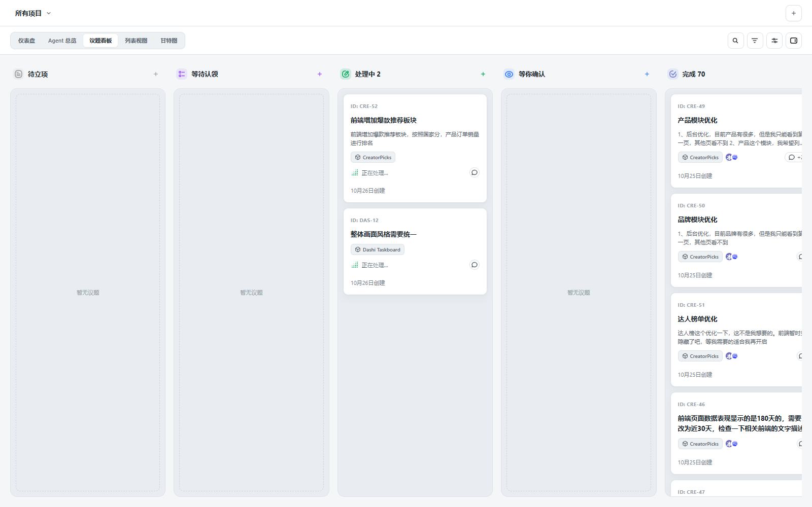
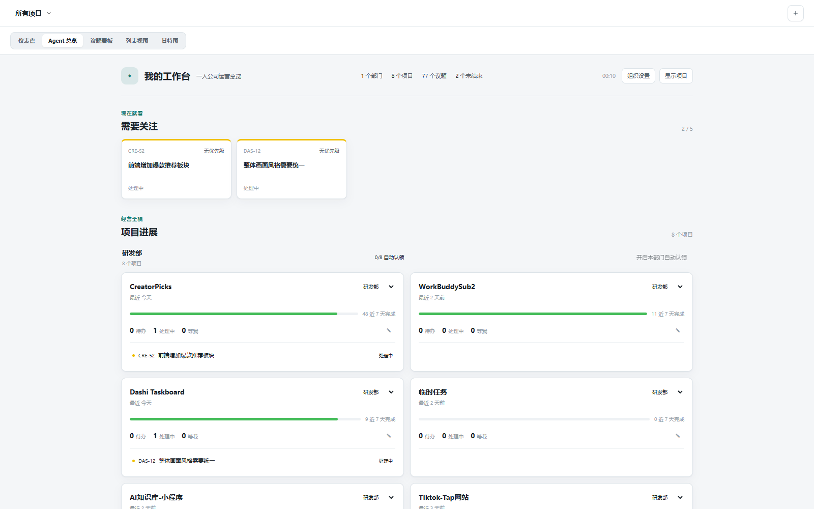

[English](README.md) | [简体中文](README.zh-CN.md)

# codex_taskboard

A local-first issue board for people who plan and ship with Codex. It runs as a web app, embeds in the Codex desktop app through the CDP launcher or injection script, and exposes the same HTTP API to the React UI and the bundled `taskctl` CLI.





## What it does

- **One board per project.** Projects carry their own workspace path, labels, README, and issues.
- **Seven issue states.** `backlog`, `todo`, `in_progress`, `in_review`, `blocked`, `done`, and `canceled`.
- **Relationships that survive.** Parent/child issues, blocking dependencies, related links, labels, priorities, due dates, and recurrence.
- **Rich issue documents.** Markdown with tables, task lists, inline images, attachments, and read-only Mermaid diagrams.
- **Real-time collaboration.** Server-sent events keep every open client in sync; reconnecting clients perform a full refresh.
- **Codex-aware.** Open an issue in a native Codex conversation, keep the conversation bound to the issue, and let Codex claim work through the bundled Skill.
- **Automation.** Create a per-project Codex cron automation that claims eligible `todo` issues and moves them through verification.
- **Optional integrations.** Jira two-way sync, a token usage ranking, Cloudflare collaboration, and a local Codex chat panel.

## Views

Every project keeps its own view selection.

| View | Purpose |
| --- | --- |
| `codex_taskboard` | First view tab: completion, progress forecast, contribution heatmap, priority/label breakdown, attention list, and running conversations. |
| Agent overview | Projects grouped by department, recent activity, completion, active issues, and automation state. |
| Issue board | Status columns with drag-and-drop, filtering, sub-issues, and conversation actions. |
| List | A dense, sortable list for scanning issues. |
| Gantt | Timeline with day/week/month zoom, today jump, and a hide-completed switch. |
| Project docs | The project's single Markdown README, editable in place. |

Only one issue per project may be `in_progress` at a time because issues normally share one working directory. A second claim returns `409 PROJECT_BUSY` with the active issue identifier.

## Requirements

- Node.js 22.5 or newer.
- macOS App and DMG builds: Xcode Command Line Tools and Rust 1.88 or newer with the `aarch64-apple-darwin` and `x86_64-apple-darwin` targets. `npm install` installs the Tauri CLI.
- Windows NSIS builds: the Microsoft Store Codex app, Rust 1.88 or newer, and Visual Studio Build Tools with the C++ workload and Windows SDK.
- Linux packages: Ubuntu 24.04 x64 and the Tauri Linux dependencies.

## Run locally

```bash
npm install
npm run build
npm start
```

Open <http://127.0.0.1:47823>. The SQLite database lives at `.data/taskboard.sqlite`.

Development mode serves the Vite UI at <http://127.0.0.1:5173> and proxies API requests to the local service:

```bash
npm run dev
```

## CLI

`taskctl` is the stable interface for scripts and agents.

```bash
npm run taskctl -- project create \
  --id my-project \
  --name "My project" \
  --workspace-path /absolute/path/to/repository

npm run taskctl -- issue create \
  --project my-project \
  --title "Implement the next slice" \
  --status todo \
  --priority high \
  --labels product,mvp
```

Run `npm link` to put `taskctl` on your shell path. Set `CODEX_TASKBOARD_URL` to target another local or LAN service, or let the CLI read the active launcher descriptor through `CODEX_TASKBOARD_RUNTIME_FILE`.

Common commands:

```bash
taskctl issue list --project my-project --status todo --sort priority --json
taskctl issue get MY-1 --json
taskctl issue move MY-1 --status in_progress --if-version 3 --json
taskctl comment add MY-1 --body "Implementation notes" --json
taskctl project readme get my-project --json
```

Reads and writes are JSON by default. The full command tree is documented in [skills/manage-taskboard/references/cli.md](skills/manage-taskboard/references/cli.md).

## Codex Skill

Copy or symlink `skills/manage-taskboard` into the Codex skills directory, then start a new Codex task:

```bash
ln -s /absolute/path/to/codex_taskboard/skills/manage-taskboard \
  ~/.agents/skills/manage-taskboard
```

The desktop app keeps the installed Skill synchronized. The Skill teaches Codex to inspect an issue and its attachments, claim it with the current version and a complete conversation binding, verify the work, and move it to `in_review`. It moves an issue to `done` only after the user explicitly accepts it.

## Project automation

codex_taskboard can create a scheduled Codex automation per project, so Codex checks for actionable `todo` issues at a fixed interval. Configure it from the embedded panel in the Codex app; the standalone browser page does not expose the project automation entry.

1. Open the embedded panel and select the project.
2. Confirm the project maps to the correct Codex project and workspace.
3. Open **Automation** in the project header and expand **Auto-claim tasks**.
4. Enable auto-claim and choose `5`, `10`, `15`, `30`, or `60` minutes.
5. Optionally enable quota limits, then choose the model and reasoning effort.

Each run:

1. Lists `todo` issues by priority, manual order, and creation time.
2. Skips issues that require waiting or have unfinished dependencies.
3. Claims one eligible issue as `in_progress` with the current version and a complete binding.
4. Implements and verifies the work in the bound project, branch, or worktree.
5. Records a result comment and moves the issue to `in_review`.
6. Never marks the issue `done`; completion requires user acceptance.

A project with an active `in_progress` issue is skipped until that issue leaves the active state. The automation stays idle when no actionable issue exists.

## Embed in Codex

### One command

Keep existing Codex windows open and run:

```bash
CODEX_TASKBOARD_HOST=127.0.0.1 npm run codex
```

The launcher starts the local service when needed, reuses an open Codex renderer with CDP, opens codex_taskboard in the native browser panel of an ordinary Codex window, or launches the official macOS Codex app with an independent profile and loopback-only port `9231`. It injects a native-looking sidebar entry after Plugins when CDP is available and keeps watching both the service and replacement renderers.

The launcher writes its authenticated endpoint to `.data/launcher-runtime.json`. A `taskctl` installed with `npm link` reads that descriptor by default, so a shell and a Codex conversation opened from the panel use the same service.

### Manual CDP

Keep the existing Codex window open. Start a second instance with a dedicated CDP port:

```bash
open -n -a /Applications/ChatGPT.app --args \
  --remote-debugging-port=9231 \
  --remote-allow-origins=http://127.0.0.1:9231
```

Then run the injector:

```bash
CODEX_TASKBOARD_HOST=127.0.0.1 \
npm run codex:inject -- --port 9231 --open
```

Keep the injector running while the panel is in use. If port `9231` is occupied, use another port in both commands.

To inject into an already running CDP-enabled Codex instance:

```bash
npm run codex:inject -- --port 9229 --open
```

The injector adds a sidebar entry and renders the iframe across Codex's main workspace, including the contextual titlebar area. It does not modify `ChatGPT.app`, its `app.asar`, or Codex data files.

**Open in conversation** selects the matching native Codex project when available and opens an unsent composer with an `e-taskboard` instruction and the issue identifier. A conversation is attributed only after it actually processes the issue: `taskctl` reads `CODEX_THREAD_ID` and records it on the issue or comment mutation. Each issue can bind one Git branch or one worktree, scanned from the selected Codex project's repository.

To use a different UI origin, set `window.__CODEX_TASKBOARD_URL__` before the user script runs. On Windows, the panel diagnostics under [tools/windows](tools/windows/README.md) explain what to check when a self-started Codex window has no CDP endpoint.

## Desktop apps

### macOS

```bash
npm run app:dev
```

To build the local app and DMG, install both Rust targets once:

```bash
rustup target add aarch64-apple-darwin x86_64-apple-darwin
npm run app:build
```

Open `src-tauri/target/universal-apple-darwin/release/bundle/macos/Codex Taskboard.app`. The DMG is in `src-tauri/target/universal-apple-darwin/release/bundle/dmg/`. Prebuilt installers are published on the [release channel](https://github.com/chuspeeism/dashi-taskboard/releases/latest).

The app bundles its own Node runtime, service, web UI, Skill, CLI wrapper, and injection script. It starts the service, injects the panel when CDP is available, and opens it without a terminal window. Data lives in `~/Library/Application Support/Codex Taskboard`; launcher logs are in `~/Library/Logs/Codex Taskboard/codex-taskboard-launcher.log`.

Local builds use ad-hoc signing. A public macOS download still requires Developer ID signing and Apple notarization.

### Windows

Install the official Codex app from the Microsoft Store, then build the current-user NSIS installer:

```powershell
npm ci
npm run app:build:windows
```

The installer is written to `src-tauri/target/x86_64-pc-windows-msvc/release/bundle/nsis/`. It installs a tray launcher, bundled Node runtime, local service, built web UI, Skill, `taskctl.cmd`, and injection script. Data lives in `%APPDATA%\Codex Taskboard`; logs are in `%LOCALAPPDATA%\Codex Taskboard\Logs`; the Skill is copied to `%USERPROFILE%\.agents\skills\manage-taskboard`.

Windows CI artifacts are unsigned and do not auto-update. Read the [code-signing policy](docs/code-signing-policy.md) before distributing a build, and see [Windows uninstall](docs/windows-uninstall.md) for retained-data behavior.

### Linux

The first Linux desktop release supports Ubuntu 24.04 LTS on x64. Install the official ChatGPT desktop `.deb` first, then install the codex_taskboard `.deb` or run the AppImage from the release channel.

```bash
sudo apt install ./<file>.deb
# or
chmod +x ./<file>.AppImage
./<file>.AppImage
```

Build both packages on Ubuntu 24.04 x64 with:

```bash
npm ci
npm run app:build:linux:x64
```

ARM64, Fedora, RPM, and other Linux distributions are not supported by the first release.

## Jira

Connect a Jira instance from the project menu. Jira Cloud accepts the Atlassian email and API token; self-hosted Jira accepts the account credentials. Choose one or more Jira projects (names or keys) to mirror into a `Jira · <account>` project.

codex_taskboard imports issues, status, priority, assignee, labels, and URLs. Changes to status or priority are pushed back through the matching Jira workflow transition or priority field. If Jira has no matching transition, the write fails rather than silently diverging.

## Token usage ranking

The header links to the token usage ranking. When usage collection is enabled and an upload token is configured, the local service records Codex thread token usage and posts batched events to the configured endpoint. The default endpoint is `https://ttokens.lusixian.com/api/token-usage/events`.

Configure it with `CODEX_TOKEN_RANKING_UPLOAD_URL` and `CODEX_TOKEN_RANKING_UPLOAD_TOKEN`, or through the local settings API. The ranking service source is in `token-ranking-server/`. Disable collection through that settings API when you do not want usage events recorded.

## Local AI chat

When the panel is opened from Codex or another loopback browser, the right side can host a local Codex chat. The panel lists models and reasoning efforts from the local Codex app server, remembers the originating project and issue, supports attachments, and can apply read-only, workspace-write, or full-access sandbox settings. Remote or trusted-tunnel requests do not receive this device-local capability.

## Configuration

| Variable | Default | Purpose |
| --- | --- | --- |
| `CODEX_TASKBOARD_HOST` | `0.0.0.0` | HTTP bind address; use `127.0.0.1` to disable LAN access |
| `CODEX_TASKBOARD_PORT` | `47823` | Local HTTP port |
| `CODEX_TASKBOARD_DATA_DIR` | `.data` | SQLite and local runtime data directory |
| `CODEX_TASKBOARD_URL` | `http://127.0.0.1:47823` | CLI API origin |
| `CODEX_TASKBOARD_RUNTIME_FILE` | launcher descriptor | Explicit runtime descriptor for the CLI |
| `CODEX_TASKBOARD_COMPANION_URL` | local service | Loopback companion used in cloud mode |
| `CODEX_TASKBOARD_TRUSTED_ORIGINS` | unset | Comma-separated exact HTTPS origins allowed through a reverse tunnel |
| `CODEX_TOKEN_RANKING_UPLOAD_URL` | `https://ttokens.lusixian.com/api/token-usage/events` | Ranking upload endpoint |
| `CODEX_TOKEN_RANKING_UPLOAD_TOKEN` | empty | Bearer token for ranking uploads |

`npm start` prints the local URL and available LAN URLs. Task, comment, attachment, and project-document changes broadcast to every open client through server-sent events. A teammate using `taskctl` can target the shared service with `CODEX_TASKBOARD_URL=http://<host-ip>:47823`.

LAN mode has no account authentication: anyone who can reach the URL on the trusted network can read and write the board. Public internet and cloud deployments need an authenticated boundary.

For a reverse tunnel, set `CODEX_TASKBOARD_TRUSTED_ORIGINS` to the tunnel's exact HTTPS origin. Origins must not contain paths, queries, fragments, credentials, or wildcards; duplicates are rejected at startup. The proxy must preserve the public `Host` and any browser `Origin`. Device-local capability routes remain unavailable through a configured public origin, even when the tunnel socket is loopback.

## Data and privacy

By default everything runs on your computer. The SQLite database and local runtime files are under `CODEX_TASKBOARD_DATA_DIR`; desktop apps use the platform data directories listed above. Board content is not sent to the project maintainers.

Network activity is limited to:

- the loopback service used by the panel, launcher, and CLI;
- the optional Jira connection you configure;
- the optional token ranking endpoint;
- the optional Cloudflare deployment you configure;
- GitHub Releases for update checks;
- OpenAI services used by the official Codex app and CLI under your own account.

See [PRIVACY.md](PRIVACY.md) for the full policy.

## Cloud collaboration

For two trusted collaborators, the board can run on Cloudflare with Worker static assets and API routes, D1 as the authoritative database, a private R2 bucket for attachments, and a Durable Object for realtime fan-out. The deployment uses HTTPS Basic Authentication with a shared password.

Each device keeps its own project checkout mapping and uses a loopback companion for Codex, Git/worktree, Skill, and MCP capabilities. Cloud mode never falls back to or double-writes the local SQLite database.

See [Cloud collaboration](docs/cloud-collaboration.md) for deployment, password rotation, local path mapping, and the one-time migration flow.

## Verify

```bash
npm run check
```

This runs TypeScript checking, a production frontend build, the component tests, and the server/CLI/injection test suite. Focused checks are also available:

```bash
npm run typecheck
npm run build:web
npm test
```

## Markdown support

Issue descriptions, comments, and project docs support GFM, including tables and task lists. Fenced `mermaid` blocks render as read-only diagrams after the viewer loads; the source remains available when rendering fails. Markdown HTML comments such as `<!-- trace-analysis:v1 ... -->` are hidden. Raw HTML is not enabled.

## Documentation

- [Cloud collaboration](docs/cloud-collaboration.md)
- [Code signing policy](docs/code-signing-policy.md)
- [Windows uninstall](docs/windows-uninstall.md)
- [Windows panel diagnostics](tools/windows/README.md)
- [Privacy policy](PRIVACY.md)
- [taskctl reference](skills/manage-taskboard/references/cli.md)

## Acknowledgements

Thanks to [Lingshan21](https://github.com/Lingshan21) for:

- The parent-based project completion proposal and initial implementation in [#371](https://github.com/chuspeeism/dashi-taskboard/pull/371), which weighted top-level parent issues equally regardless of how many children each had.
- The priority organization proposal and initial implementation in [#372](https://github.com/chuspeeism/dashi-taskboard/pull/372). The final board sorting controls were adapted to the maintainer's requirements instead of adopting the proposed priority swimlanes.

## License

[Apache License 2.0](LICENSE)
